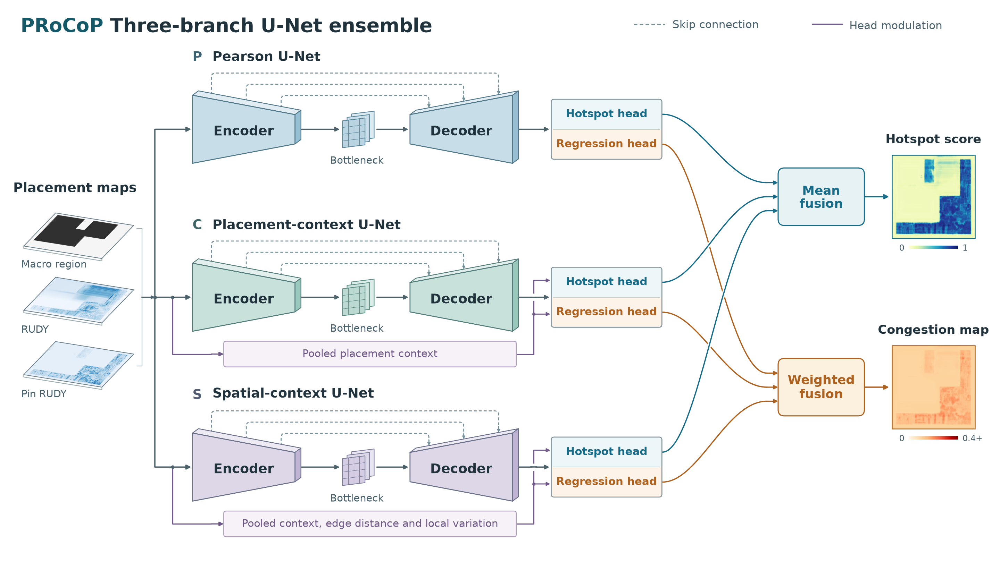

# PRoCoP — Placement-Based Routing Congestion Prediction

PRoCoP predicts where an ASIC layout will run out of routing capacity before global routing. Given three placement-stage maps, it estimates congestion on a 256 × 256 grid and ranks tiles for inspection. The project evaluates how well these rankings transfer to unseen circuit designs. The best of 21 evaluated methods is a three-model U-Net ensemble with **0.28353 mean hotspot average precision (AP)** across six held-out designs.

[Run the best model](#run-the-best-model-with-saved-weights) · [Compare all 21 methods](docs/MODEL_COMPARISON.md) · [View 24 layout predictions](figures/README.md#held-out-layout-samples)



## Set up the environment

From a fresh checkout, run the following in Bash. If you already have the repository and the `procop` environment, activate it and run commands from the project root.

```bash
git clone https://github.com/RickGao/PRoCoP.git
cd PRoCoP
conda create -n procop python=3.12 pip -y
conda activate procop
python -m pip install -r requirements.txt
python smoke_check.py
```

The smoke check trains on small synthetic maps on CPU and prints `PASS` on success. Training and replay automatically select CUDA, then Apple MPS, then CPU. To use a specific GPU build, install the matching PyTorch package in the environment before installing the remaining requirements. [PyTorch installation guide](https://pytorch.org/get-started/locally/)

## Run the best model with saved weights

Use this path in the experiment workspace, where `data/n28_full/` and the archived `runs/` directory are available. Git excludes the dataset, checkpoints and run reports. For a source-only checkout, use the dataset and training steps below.

```bash
python replay_model.py spatial_consensus                    # Run inference on RISCY-FPU-b
python replay_model.py placement_context --design RISCY-a   # Run the best single network
python rank_models.py                                       # Print the saved six-fold ranking
```

The first command loads the three checkpoints for the fold, applies the alarm threshold chosen on its validation circuit, prints test metrics and writes a new JSON report under `runs/replays/`. On the default test design (`RISCY-FPU-b`, 1,248 layouts), the archived ensemble scored **0.09997 AP** and **0.03003 MAE**. Add `--print-command` to inspect the exact checkpoint paths or `--device cuda` to request CUDA. [Commands for all 21 methods (Chinese)](docs/RUN_MODELS.md)

## Get the dataset

Download the **CircuitNet-N28 routability features**. This project uses four archives from the 28 nm release. [Official dataset download](https://circuitnet.github.io/intro/download.html#circuitnet-n28) · [Feature definitions](https://circuitnet.github.io/feature/routability%20features.html) · [CircuitNet reference code](https://github.com/circuitnet/CircuitNet)

Keep the files compressed and arrange them as shown. If `data/n28_full/manifest.csv` already exists in your workspace, go directly to training.

```text
CircuitNet-N28/routability_features/
├── macro_region.tar.gz
├── RUDY/
│   ├── RUDY.tar.gz
│   └── RUDY_pin.tar.gz
└── congestion/congestion_global_routing/
    └── overflow_based.tar.gz
```

```bash
python prepare_n28.py --source CircuitNet-N28/routability_features --out data/n28_full
```

The output directory must be new. For a smaller first run, add `--per-design 32`, use `--out data/n28_pilot`, and pass its manifest to training. The full experiment contains **10,242 layouts across six designs**. Each row in `manifest.csv` pairs two NumPy files using paths relative to the manifest.

| File | Shape on disk | Contents |
|---|---|---|
| `feature/<layout>.npy` | `(256, 256, 3)` | Macro region, RUDY and pin RUDY, in that order |
| `label/<layout>.npy` | `(256, 256, 1)` | Horizontal plus vertical global-routing overflow, min–max normalized per layout |

## Train from scratch

### FCN baseline

This example holds out `RISCY-FPU-b` for testing, uses `RISCY-b` for validation and trains on the other four designs. Choose a fresh output directory each time.

```bash
python train.py --manifest data/n28_full/manifest.csv \
  --test-design RISCY-FPU-b --val-design RISCY-b --model fcn \
  --epochs 15 --batch-size 4 --lr 0.002 --alpha 0 --seed 42 \
  --select-by ap --out runs/my_fcn

python train.py --show-results runs/my_fcn
```

The run saves `best.pt`, its configuration and training history, and validation and test metrics. Use `--model unet` and a new output directory for the single-head U-Net baseline. The training script's default alarm cutoff differs from the validation-calibrated cutoff used for F1 in the formal comparison.

### Three-model ensemble

The ensemble combines a Pearson-trained dual-head U-Net, a placement-context U-Net and a spatial-context U-Net with a hotspot ranking loss. The three members contribute equally to each tile's hotspot score. Their weights for continuous congestion are 50%, 25% and 25%, respectively. Run both blocks below in the same Bash session.

```bash
mkdir -p runs
run_dir=$(mktemp -d runs/ensemble_XXXXXX)
common=(--manifest data/n28_full/manifest.csv --test-design RISCY-FPU-b --val-design RISCY-b
        --epochs 15 --batch-size 4 --lr 0.002 --workers 4 --seed 42 --threshold-seed 42
        --alpha 0 --hotspot-loss-weight 0.01 --correlation-loss-weight 0.005 --select-by ap --val-only)

python train.py "${common[@]}" --model unet-hotspot --out "$run_dir/pearson"
python train.py "${common[@]}" --model unet-context --out "$run_dir/context"
python train.py "${common[@]}" --model unet-spatial --ap-loss-weight 0.005 --out "$run_dir/spatial_ap"
```

Select the alarm cutoff on the validation design, then freeze it for the held-out test. The last command prints the ensemble results and the location of the new test report.

```bash
ensemble=(--methods spatial_consensus --pearson "$run_dir/pearson"
          --context "$run_dir/context" --spatial-ap "$run_dir/spatial_ap")

python compare_hotspot_methods.py "${ensemble[@]}" \
  --split validation --calibrated --out "$run_dir/validation.json"
python compare_hotspot_methods.py "${ensemble[@]}" \
  --split test --thresholds-from "$run_dir/validation.json" --out "$run_dir/test.json"
```

## Results on unseen designs

Each design serves as the test set once. All variants of a design stay together within a fold. AP ranks all test tiles in a fold by their predicted hotspot scores. MAE measures absolute error on the normalized congestion map. True hotspot cutoffs come from training data. The six designs have equal weight in the table. [Full model comparison and per-design results](docs/MODEL_COMPARISON.md)

| Method | Hotspot AP ↑ | MAE ↓ |
|---|---:|---:|
| RUDY | 0.19842 | 0.11570 |
| FCN | 0.25827 | 0.03448 |
| Single-head U-Net | 0.26122 | 0.03425 |
| Placement-context dual-head U-Net | 0.27982 | 0.03437 |
| Three-model ensemble | **0.28353** | 0.03407 |

## Repository guide

Run the Python commands from the repository root.

| Workflow | Entry points |
|---|---|
| Prepare data and check the environment | [Dataset preparation](prepare_n28.py), [synthetic smoke check](smoke_check.py) |
| Define and train networks | [Architectures](model.py), [training and validation](train.py) |
| Score hotspots and compare methods | [Evaluation and calibration](compare_hotspot_methods.py), [ranking metrics](ranking.py), [saved score-map evaluation](evaluate_ranking.py), [fusion weights](fusion.py) |
| Replay a fold or display results | [Checkpoint replay](replay_model.py), [model rankings](rank_models.py) |
| Reproduce ablations and diagnostics | [Spatial study](run_spatial_study.py), [regional diagnostics](spatial_diagnostics.py), [study summaries](summarize_study.py) |
| Render the layout gallery | [PNG generator](plot_samples.py), [sample manifest](figures/samples.csv) |

The `docs/` directory contains the [model runbook](docs/RUN_MODELS.md), [model comparison](docs/MODEL_COMPARISON.md), [experiment protocols](docs/EXPERIMENTS.md) and [iteration log](docs/ITERATION_LOG.md). Shell examples in these documents assume the repository root as the working directory.

The [figure gallery](figures/README.md) is included in the repository. To regenerate it in the experiment workspace, run `python plot_samples.py`. The generator reads the prepared layouts from `data/n28_full/` and the fold checkpoints and validation reports from `runs/`, then writes four PNGs per design to `figures/<design>/`.
