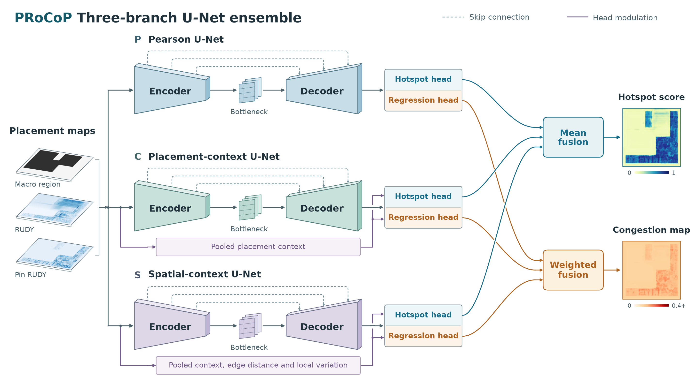

# PRoCoP figures

## Ensemble architecture

## Held-out layout samples

24 PNG images, four per circuit design. Each image uses the same 2880 × 1620 layout and shows the three placement inputs, the ensemble prediction, global-routing ground truth, and hotspot detection. Select a layout ID to open the image.

| Test design | P20 | P40 | P60 | P80 |
|---|---:|---:|---:|---:|
| RISCY-FPU-a | [4884](RISCY-FPU-a/01_4884-RISCY-FPU-a-2-c5-u0.png) | [4911](RISCY-FPU-a/02_4911-RISCY-FPU-a-2-c5-u0.png) | [5161](RISCY-FPU-a/03_5161-RISCY-FPU-a-2-c20-u0.png) | [5835](RISCY-FPU-a/04_5835-RISCY-FPU-a-3-c20-u0.png) |
| RISCY-FPU-b | [6644](RISCY-FPU-b/01_6644-RISCY-FPU-b-2-c20-u0.png) | [6590](RISCY-FPU-b/02_6590-RISCY-FPU-b-2-c5-u0.png) | [5969](RISCY-FPU-b/03_5969-RISCY-FPU-b-1-c5-u0.png) | [6267](RISCY-FPU-b/04_6267-RISCY-FPU-b-1-c20-u0.png) |
| RISCY-a | [267](RISCY-a/01_267-RISCY-a-1-c5-u0.png) | [317](RISCY-a/02_317-RISCY-a-1-c5-u0.png) | [1046](RISCY-a/03_1046-RISCY-a-2-c5-u0.png) | [1140](RISCY-a/04_1140-RISCY-a-2-c5-u0.png) |
| RISCY-b | [3306](RISCY-b/01_3306-RISCY-b-2-c20-u0.png) | [2647](RISCY-b/02_2647-RISCY-b-1-c20-u0.png) | [2342](RISCY-b/03_2342-RISCY-b-1-c5-u0.png) | [2229](RISCY-b/04_2229-RISCY-b-1-c2-u0.png) |
| zero-riscy-a | [7785](zero-riscy-a/01_7785-zero-riscy-a-1-c20-u0.png) | [7662](zero-riscy-a/02_7662-zero-riscy-a-1-c20-u0.png) | [8381](zero-riscy-a/03_8381-zero-riscy-a-2-c20-u0.png) | [8410](zero-riscy-a/04_8410-zero-riscy-a-2-c20-u0.png) |
| zero-riscy-b | [9736](zero-riscy-b/01_9736-zero-riscy-b-2-c5-u0.png) | [10086](zero-riscy-b/02_10086-zero-riscy-b-3-c5-u0.png) | [9791](zero-riscy-b/03_9791-zero-riscy-b-2-c5-u0.png) | [9590](zero-riscy-b/04_9590-zero-riscy-b-1-c5-u0.png) |

P20–P80 refer to within-design **layout AP** in the eligible sample. For each design, 48 layouts were originally sampled without replacement (seed 2026) after excluding the first illustrated examples. Of those 48, four already appeared in subsequent figures. The four new examples lie nearest the 20th, 40th, 60th and 80th percentile **rank positions** among the remaining 44, ordered by ensemble AP then layout ID. All shown cases are held out from the corresponding training fold.

Prediction and ground truth share a linear normalized overflow scale from 0 to 0.40, with larger values shown in the terminal color. In the overlay, teal marks hits, orange false alarms, and purple misses. The alarm thresholds were selected on the validation designs. The displayed AP and detection metrics refer to the individual layout.

[Sample IDs, input and label paths, thresholds and metrics](samples.csv). Run `python plot_samples.py` from the project root in the experiment environment to regenerate the PNGs.
