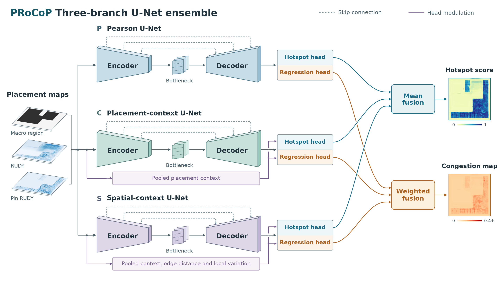

# PRoCoP 课程报告中文摘要

## 研究问题

工程师已经摆好了标准单元和宏单元，下一步要用有限的金属布线资源把它们连起来。如果许多网络都想穿过同一条狭窄通道，全局布线时那里就可能出现溢出。PRoCoP 希望提前回答两个问题：拿到一个训练时没见过的电路，应该先检查哪些区域？如果系统直接发出报警，又会漏掉多少热点、产生多少误报？

## 已有方法

RUDY 的全称是 Rectangular Uniform Wire Density。它把一条网络的预估布线需求均匀分摊到引脚围成的矩形中，再累加所有网络的贡献，得到一张需求图。这个方法计算快，但实际走线可能绕过宏单元。已有研究用卷积网络从布局图中学习这些空间规律，也有方法直接利用网表中的连接关系。本项目选择三张布局图作为统一输入，让启发式方法、单个网络和融合模型在相同条件下比较。

## 数据与验证方式

CircuitNet-N28 提供 6 个电路设计、共 10,242 份布局。每份布局的三个输入通道分别表示宏单元区域、RUDY 和引脚位置的需求估计 Pin RUDY。监督信号是全局布线后水平与垂直溢出量的和，缩放到每份布局自身的 0～1 范围，最终为 256 × 256 网格。因此，输出可以标出同一布局中相对严重的区域，无法直接换算为缺少多少条布线轨道。

每轮留出一个完整设计做测试、另一个做验证，其余四个训练。每个设计轮流测试一次。真实热点的阈值取训练集中正值标签抽样的第 90 百分位，模型在验证集 AP 最高的轮次保存。需要报警时，再在验证设计上选使 F1 最大的预测分数阈值，固定后用于测试。每折先单独计算指标，再给六个设计相同的权重。

## 最佳模型的结构

三个独立训练的双头 U-Net 同时读取同一组输入。每个网络都输出两张图，一张估计拥塞程度，另一张给网格打热点分数。

| 分支 | 它学习什么 |
|---|---|
| P，Pearson U-Net | 同时学习连续拥塞和热点分类，并在训练中加入空间相关性损失，让预测图的高低起伏更接近真实图。 |
| C，布局上下文 U-Net | 在相同训练目标上加入局部、分区、整行、整列和全局统计，帮助判断高需求是否沿一条通道延伸。 |
| S，空间上下文 U-Net | 在上下文分支上加入到芯片边缘的距离和局部波动程度，并用近似 AP 损失鼓励真实热点排得更靠前。 |

推理时，热点分数按 P、C、S 各 1/3 平均。连续拥塞图按 P 占 1/2、C 和 S 各占 1/4 融合。整套模型共 365,318 个参数，每份布局需要三次网络前向计算。

## 实验结果

AP 衡量沿分数排序向下检查时，真实热点是否集中在前面；越高越好。MAE 衡量每个网格的拥塞预测值平均偏离真值多少；越低越好。

| 方法 | 六折热点 AP ↑ | 六折 MAE ↓ |
|---|---:|---:|
| RUDY | 0.19842 | 0.11570 |
| FCN | 0.25827 | 0.03448 |
| 单头 U-Net | 0.26122 | 0.03425 |
| 布局上下文 U-Net（C） | 0.27982 | 0.03437 |
| Pearson + 空间上下文（P + S） | 0.28106 | 0.03432 |
| 最终三模型（P + C + S） | **0.28353** | 0.03407 |

三模型在 21 种方法中取得最高六折平均 AP，而且在六个测试设计上都超过 RUDY 和 FCN。相对 FCN，其 AP 提高 9.78%；相对 RUDY 提高 42.90%。普通双头 U-Net 的 AP 是 0.25985，仅仅多加一个分类头没有超过单头 U-Net。加入相关性损失后达到 0.26944，再加入布局上下文达到 0.27982。第三个模型带来的增益较小，从最佳双模型的 0.28106 升到 0.28353，绝对差为 0.00247。

原计划中的拥塞加权 MSE 单独做了 FCN 小样本对照，按验证 MAE 选权重。在该试验的固定阈值下，测试 F1 从 0.77% 升到 4.62%。后来在全量单头 U-Net 上比较损失时，普通 MSE 的验证 AP 更高。这两组结果回答不同的问题。

## 实际能找到多少热点

把每个验证设计选出的报警阈值用到对应测试设计，最终三模型的六折平均召回率为 **58.75%**，平均精确率为 **25.24%**，平均 F1 为 **31.94%**。直观地说，平均能找到接近六成的真实热点，每四个报警约有一个命中。AP 0.28353 表示排序质量，不能解释为“找到了 28.35% 的热点”。

以正文的 RISCY-FPU-a 布局 4911 为例，模型找出 5,495 个真实热点中的 4,951 个，召回率达 90.1%；它同时标了 21,176 个网格，因此精确率只有 23.4%。这是单份布局的例子，与六折平均分开解读。

## 结论与边界

只用布局阶段的信息，就可以比直接看 RUDY 更可靠地排列拥塞风险。布局上下文带来了较大的单模型收益，融合进一步改善排序，但阈值迁移给新电路时仍会产生较多误报。三模型是看到前两折结果后追加的方案，在随后四折的平均 AP 也超过两个双模型；在 RISCY-FPU-b 更换训练种子后，原双模型略胜三模型。六个设计均属相关的 RISC-V 系列，结果还不能说明模型迁移到其他芯片家族或制程后的效果。

对公开方法，报告只比较能对齐的 zero-riscy-b 单折。三模型的全图 Pearson 为 0.35162，三通道 Pixel Diffusion 为 0.3077，十通道 CLDRoute 为 0.3687。该论文未报告与本项目同定义的热点 AP，因此无法给出两者的热点排序差距。
